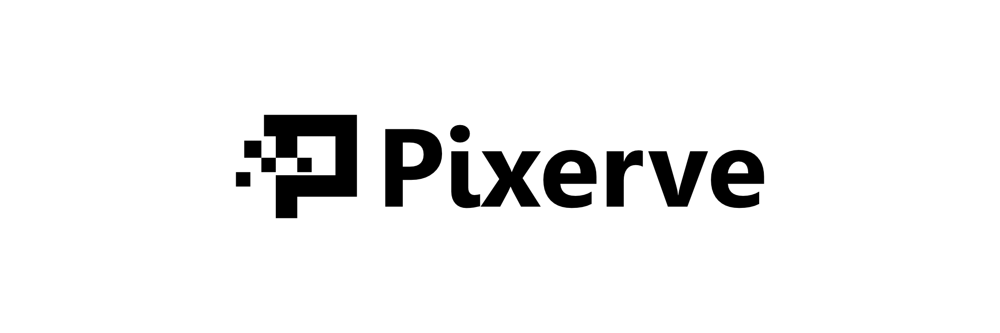

# Pixerve

Serve resized images from local storage or an S3-compatible bucket. Pixerve
handles resizing, cropping, JPEG/PNG/WebP/AVIF conversion, and watermarked social
cards, with signed URLs and caching for browser and CDN delivery.

## Install

Run the published Docker image:

```sh
docker run -d --name pixerve \
  -p 127.0.0.1:3000:3000 \
  ghcr.io/xviidev/pixerve:v0.1.2
```

The image starts with a bundled sample. Windows users can download the portable
package with its native libraries included. See [installation](apps/docs/src/content/docs/start/installation.md)
for downloads, configuration, and storage setup.

## Use

Request a resized WebP image:

```sh
curl 'http://localhost:3000/tr:f-webp,w-320/example.png' -o example.webp
```

Use a preset for a cropped card, or specify dimensions:

```text
/example.png?p=card&f=webp
/example.png?w=640&h=360&fit=cover&f=avif
```

Query URLs redirect to a canonical image URL. Use the CLI or JavaScript SDK to
generate that URL directly when integrating with a CMS.

The default configuration is public and allows five transform requests per IP
per minute. Configure local storage or S3, choose an
[access policy](apps/docs/src/content/docs/guides/signing.md), and put the service
behind HTTPS. Use private mode for images that require restricted access.

## Documentation

Read the [Pixerve documentation](https://pixerve.xvii.dev/).

The [JavaScript and TypeScript SDK](https://github.com/xviidev/pixerve-js)
generates canonical URLs for browser and backend applications:

```sh
npm install @xviidev/pixerve
```

Use `@xviidev/pixerve` for public URLs and `@xviidev/pixerve/server` for signing
in Node.js. Keep signing keys on the backend.

- [Install and configure Pixerve](https://pixerve.xvii.dev/start/installation/)
- [Resize, crop, and convert images](https://pixerve.xvii.dev/start/usage/)
- [Connect a CMS](https://pixerve.xvii.dev/guides/cms/)
- [Signing and private images](https://pixerve.xvii.dev/guides/signing/)
- [CDN caching](https://pixerve.xvii.dev/guides/delivery/)
- [HTTP API](https://pixerve.xvii.dev/reference/http/) and [configuration](https://pixerve.xvii.dev/reference/configuration/)

For source builds and development, see [Contributing](CONTRIBUTING.md).

## License

An application license has not been selected. Native dependencies retain their own licenses.
