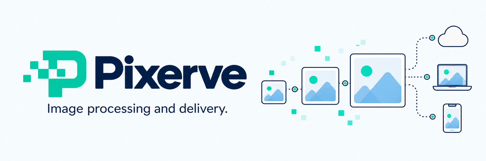

# Pixerve



**Fast, resource-efficient image processing and delivery.**

Pixerve is an HTTP image service built with Rust and libvips. Resize, crop,
convert, and serve images from local storage or an S3-compatible bucket, with
bounded processing, persistent caching, signed URLs, and CDN-aware responses.

Designed for websites, publishing platforms, and applications that need image
delivery without repeatedly downloading and encoding the same source.

## Features

- **Image processing:** JPEG, PNG, WebP, and AVIF output; EXIF orientation,
  five resize modes, positional and smart cropping, blur, backgrounds, and alpha.
- **Social images:** a dedicated 1200 × 630 JPEG endpoint with a watermark.
- **Predictable resource use:** bounded requests, workers, and queue; source and
  output limits; concurrent requests for the same variant share one job.
- **Two cache layers:** bounded RAM and persistent disk results, checked before
  downloading the source.
- **CDN integration:** canonical URLs, selective `Vary: Accept`, conditional
  requests, verified content-hashed sources, and versioned immutable assets.
- **Access policies:** stable public asset signatures, expiring signed URLs,
  private responses, and an optional CDN-to-origin access token.
- **Observability:** protected Prometheus metrics, cache diagnostics, and latency
  histograms without per-image metric labels.

Available codecs depend on the installed libvips build. Pixerve currently ships
as an executable HTTP service, not a published Rust library or SDK.

## Project status

Pixerve is a standalone repository. Cargo.toml, Dockerfile, static assets, scripts,
and CI workflows live in its root. Its package, executable, and log target are
named `pixerve`. Run commands from this repository root unless noted otherwise.
Published GitHub Releases trigger tested Linux Docker publication to GHCR.
Branch/PR builds only produce workflow artifacts. See the
[release publishing guide](docs/distribution.md#publish-a-release-image-to-ghcr).
A published registry image is not assumed until that workflow succeeds.

Latest local validation passed **10 Rust tests and 149 HTTP/image checks** on Windows
with Rust 1.92 and libvips 8.18.2 using the debug executable. Release and Linux
checks run in GitHub Actions. Live CDN rules and comparative CPU/RAM benchmarks
have not been validated; resource defaults are controls, not performance claims.

## Quick start

Requirements: Rust 1.88 or newer, a C linker, and libvips with your required
codecs. See [installation](docs/installation.md) for Windows and Linux details.

Run from the current checkout root:

```sh
cp .env.example .env
```

For a local demo, edit `.env`:

```dotenv
SOURCE_DIR=static
STATIC_DIR=static
OG_WATERMARK=assets/og_wm.png
SIGNING_KEY=
```

The project provides a neutral sample image and a transparent starter overlay.
Replace them with your own sources and branding as needed. A watermark file is
required at startup even when you do not request social images.

```sh
cargo build --release --locked
./target/release/pixerve
```

In another terminal:

```sh
curl http://localhost:3000/health
curl -L 'http://localhost:3000/example.png?w=320&f=webp' -o preview.webp
```

The unsigned demo allows five transform requests per IP per 60 seconds by default.
Configure signing for production transform URLs. The server listens on
`0.0.0.0:3000`; terminate HTTPS at your proxy.

## Image URLs

| Purpose | URL |
|---|---|
| Original source bytes | `/photos/example.jpg` |
| Explicit transformation | `/tr:f-webp,w-640,q-75/photos/example.jpg` |
| Query transformation | `/photos/example.jpg?w=640&q=75&f=webp` |
| Named preset | `/photos/example.jpg?p=card&f=webp` |
| Social image with watermark | `/og/photos/example.jpg` |
| Local static file | `/static/logo.png` |

Query/preset requests redirect to canonical URLs by default. Examples omit
signatures for readability; ordinary transformations require a valid signature
when `SIGNING_KEY` is set. Private mode requires signatures for every image route.
See the [HTTP API](docs/api.md) and [signing guide](docs/signing.md).

## Publish a cache-friendly public asset

With `SIGNING_KEY` configured on the server or CMS:

```sh
./target/release/pixerve version ./photo.jpg photos
# Upload the exact source bytes using the returned key.
./target/release/pixerve asset 'photos/photo-<full-sha256>.jpg' 'p=card,f=webp'
```

Replace `<full-sha256>` with the complete 64-character hash. The second command
returns a canonical URL containing `pv` and a stable `asig` signature. Under the
default public policy, a verified hashed source, matching pipeline version, and
fixed output format qualify for one year of immutable browser/CDN caching.

Use expiring signatures and `CACHE_VISIBILITY=private` for private content.
Public asset signatures limit origin transformations; they do not make an image
confidential. See [CDN delivery](CDN.md) for retention and pipeline upgrades.

## Resource defaults

| Control | Default |
|---|---|
| Active image jobs / waiting unique jobs | 1 / 16 |
| Concurrent image requests | 128 |
| libvips concurrency | 1 |
| RAM / disk result cache | 8 MiB / 256 MiB |
| Origin result TTL / RAM idle expiry | 24 hours / 5 minutes |
| Source bytes / decoded input pixels | 20 MiB / 40 million pixels |
| Output pixels | 12 million pixels |

These settings do not cap process RSS. Native codecs, active buffers, allocator
retention, and the operating system also use memory. There is no application
source polling or prewarming loop while idle. See [architecture](docs/architecture.md).

## Documentation

Start with the [documentation index](docs/README.md), or go directly to:

- [Installation and local development](docs/installation.md)
- [Brand images, default Open Graph, and placeholders](docs/branding.md)
- [Portable Windows packages, Docker artifacts, and CI](docs/distribution.md)
- [HTTP API, transforms, presets, and errors](docs/api.md)
- [Complete environment reference](docs/configuration.md)
- [CLI and URL signing](docs/signing.md)
- [Caching, Cloudflare, Fastly, and frontend delivery](CDN.md)
- [Deployment and migration](docs/deployment.md)
- [Metrics, troubleshooting, and benchmarks](docs/operations.md)
- [Architecture and limits](docs/architecture.md)
- [Contributing and publication preparation](CONTRIBUTING.md)

## Development

```sh
cargo fmt --check
cargo test --locked
cargo build --release --locked
npm ci
node scripts/smoke.mjs
```

The HTTP suite additionally needs Node.js and Sharp. It uses project-owned runtime
samples, temporary fixtures, and mock S3, not a production bucket.
See [contributing](CONTRIBUTING.md) for layout and test requirements.

## License

A distribution license has not yet been selected for the Pixerve application.
Native libraries and dependencies retain their respective licenses. Do not infer
an MIT or Apache license from the Rust ecosystem or the planned repository name.
