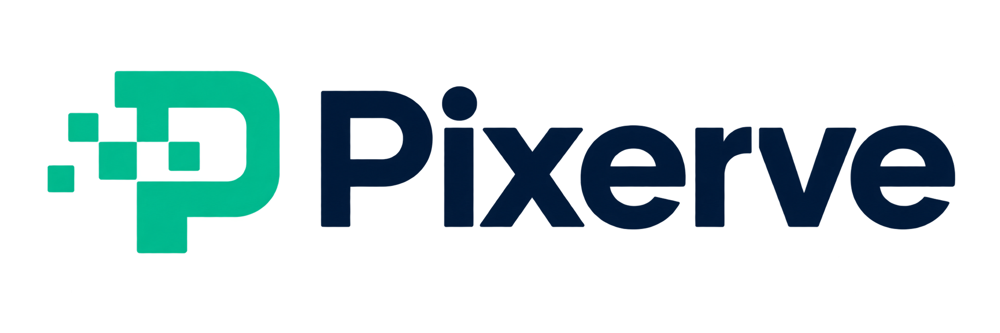

# Pixerve logo

The horizontal logo combines a pixel-based P symbol with the Pixerve wordmark.
The teal symbol represents image pixels and delivery; the navy wordmark is
intended for light surfaces. The PNG preserves a transparent background.

This is a raster logo concept, not an SVG/vector master. Generated with the
built-in image generation tool. The complete generation prompt is recorded below.

## Generation prompt

Use case: logo-brand. Asset: official horizontal logo for Pixerve, a fast, resource-efficient image transformation and delivery service built with Rust and libvips, designed for CDN delivery. Create one polished original logo lockup, not a presentation board. On the left a distinctive compact geometric P symbol: an image frame and a few precisely aligned square pixels form a clear P with a subtle forward motion or delivery cue. Cohesive silhouette, minimal components, legible at favicon size. On the right the exact word "Pixerve" spelled P i x e r v e, beautifully kerned custom modern sans-serif, medium-bold, confident and restrained. Choose an elegant vivid teal/emerald accent for the icon and deep midnight navy wordmark. Flat vector-like clean shapes, crisp edges, professional open-source developer-tool identity. Wide horizontal composition with generous transparent margin. Background genuinely transparent, no white rectangle, no checkerboard drawn in. No tagline, no extra lettering, no gradients, no 3D, no shadows, no mockups, no stock mountain/sun image icon, no Rust gear or crab. Output a single finished logo, with icon and wordmark at balanced scale.

## Companion images

| Asset | File |
|---|---|
| Default Open Graph card | [default-og.png](../static/default-og.png) |
| README hero cover | [readme-cover.png](../static/readme-cover.png) |
| Transparent icon master | [pixerve-icon.png](../static/pixerve-icon.png) |
| Image-unavailable placeholder | [placeholder.png](../static/placeholder.png) |

See [usage and dimensions](../docs/branding.md) and the complete
[companion generation prompts](asset-prompts.md). Companion images use the
original logo as the brand reference and were generated with the built-in tool.
